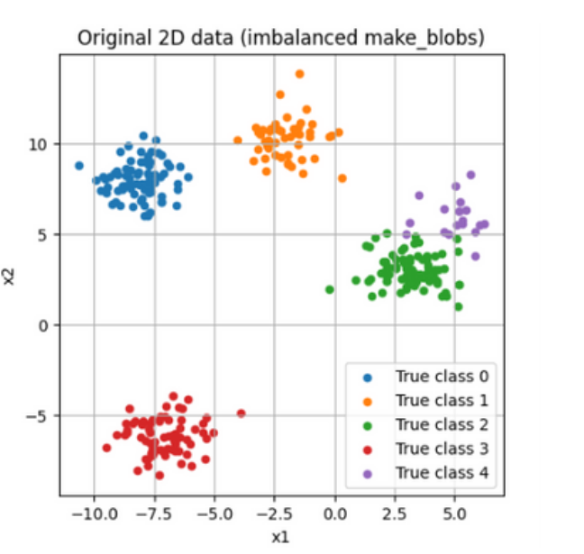
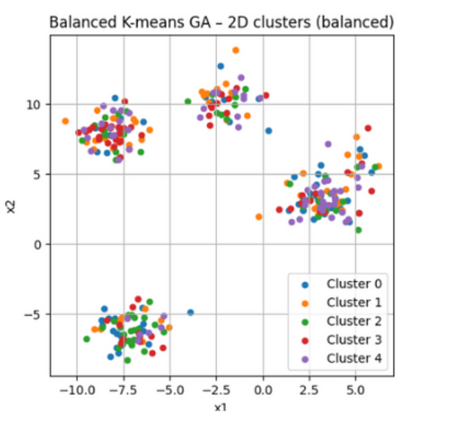
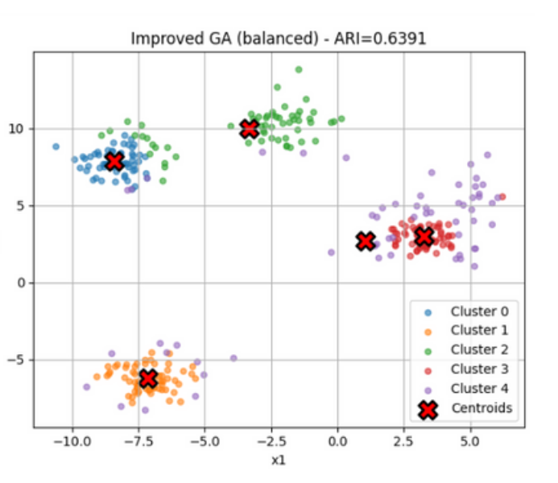

# Constrained Clustering Using Genetic Algorithms: Balanced K-means Optimization

A Combinatorial Optimization project that improves balanced K-means clustering using Genetic Algorithms, hybrid initialization, adaptive mutation, and constrained local search.

## Overview

Clustering is an unsupervised Machine Learning task that groups similar data points into clusters based on their characteristics.

However, traditional K-means does not guarantee balanced cluster sizes. It can produce clusters with significantly different numbers of data points, which may be undesirable when equal or nearly equal cluster sizes are required.

This project addresses the **Constrained Clustering Problem** by combining K-means with a Genetic Algorithm (GA) to optimize cluster assignments under strict balancing constraints.

The main objective is to obtain compact and balanced clusters while minimizing the Within-Cluster Sum of Squares (WCSS).

Starting from a baseline implementation, several optimization strategies were studied and introduced to improve the Genetic Algorithm:

- Hybrid initialization.
- Adapted mutation operators.
- Constrained local search.
- Adaptive mutation rate adjustment.

Across 20 independent runs, the improved implementation reduced WCSS from **17,862.98 to 3,107.97**, representing an approximately **83% reduction**, and improved the Adjusted Rand Index (ARI) from **0.0171 to 0.6284**.

## Project Objectives

- Study the constrained clustering optimization problem.
- Understand the limitations of traditional K-means under cluster balancing constraints.
- Implement a Genetic Algorithm for balanced cluster assignment.
- Investigate different initialization and mutation strategies.
- Improve solution quality through constrained local search.
- Adapt the mutation rate during the optimization process.
- Compare the baseline and improved implementations.
- Evaluate optimization performance across multiple independent runs.

## Problem Definition

The objective is to partition a dataset into \(K\) clusters while satisfying cluster-size constraints.

Traditional K-means attempts to minimize the Within-Cluster Sum of Squares but does not explicitly enforce balanced cluster sizes.

In this project, the clustering problem is formulated as a constrained optimization problem.

### 1. Within-Cluster Sum of Squares (WCSS)

WCSS measures the compactness of clusters by calculating the sum of squared distances between each data point and its assigned cluster centroid.

\[
WCSS = \sum_{j=1}^{K}\sum_{x_i \in C_j}
\|x_i-\mu_j\|^2
\]

Where:

- \(K\): Number of clusters.
- \(C_j\): Set of data points assigned to cluster \(j\).
- \(x_i\): A data point.
- \(\mu_j\): Centroid of cluster \(j\).

A lower WCSS indicates more compact clusters.

### 2. Cluster Balancing Constraint

The clustering algorithm must distribute data points across clusters according to the specified balancing constraints.

For a dataset containing \(N\) samples and \(K\) clusters, an equal-size assignment has:

\[
|C_j| = \frac{N}{K}
\]

When exact equality is not possible because of indivisible sample counts, cluster capacities can be defined using the corresponding lower and upper bounds.

The balancing constraint prevents the algorithm from producing highly unequal cluster sizes.

## Proposed Solution: Genetic Algorithm

Genetic Algorithms are population-based metaheuristic optimization algorithms inspired by natural evolution.

Instead of searching for a solution through a single sequence of decisions, a Genetic Algorithm maintains a population of candidate solutions and improves them through evolutionary operations.

In this project, each candidate solution represents a possible assignment of data points to clusters.

The optimization process follows these main stages:

### 1. Population Initialization

Generate an initial population of candidate clustering solutions.

Hybrid initialization combines different initialization strategies to improve population diversity and provide better starting solutions.

### 2. Fitness Evaluation

Evaluate candidate solutions according to their clustering quality.

The main optimization objective is to minimize WCSS while satisfying the cluster balancing constraints.

### 3. Selection

Select candidate solutions for reproduction based on their fitness.

Better solutions have a greater chance of contributing to the next generation.

### 4. Crossover

Combine information from selected parent solutions to generate new candidate assignments.

The generated solutions must respect the clustering constraints.

### 5. Mutation

Modify selected cluster assignments to introduce diversity and explore new solutions.

Adapted mutation operators are used to improve exploration while maintaining valid cluster assignments.

### 6. Constrained Local Search

Improve candidate solutions through local modifications while respecting cluster balancing constraints.

This allows the algorithm to refine solutions beyond the standard genetic operations.

### 7. Adaptive Mutation Rate

Adjust the mutation rate during optimization rather than relying exclusively on a fixed mutation probability.

The objective is to balance exploration of new solutions and exploitation of promising candidates.

### 8. Termination

Repeat the evolutionary process until the stopping criterion is reached.

The best valid clustering solution is retained.

## Optimization Strategies

The project investigates several strategies to improve the baseline Genetic Algorithm.

| Strategy | Purpose |
|---|---|
| Hybrid Initialization | Improve initial population quality and diversity |
| Adapted Mutation Operators | Explore alternative cluster assignments |
| Constrained Local Search | Refine solutions while preserving feasibility |
| Adaptive Mutation Rate | Balance exploration and exploitation |

These strategies aim to improve both the quality of the clustering solutions and the effectiveness of the optimization process.

## Experimental Results

The improved Genetic Algorithm was evaluated through 20 independent runs and compared with the baseline implementation.

### 1. Quantitative Performance

| Metric | Baseline | Improved GA |
|---|---:|---:|
| WCSS | 17,862.98 | 3,107.97 |
| Adjusted Rand Index (ARI) | 0.0171 | 0.6284 |

**WCSS improvement:**

\[
\text{Reduction} =
\frac{17862.98-3107.97}{17862.98}
\times 100
\]

\[
\boxed{\text{WCSS Reduction} \approx 82.60\%}
\]

The improved algorithm significantly reduces the clustering objective while producing a better agreement with the reference partition according to ARI.

**ARI improvement:**

The ARI increases from 0.0171 to 0.6284, indicating a substantial improvement in agreement between the obtained clustering and the reference labels.

### 2. Clustering Visualizations

The following visualizations illustrate the difference between the initial clustering, the balanced baseline solution, and the optimized solution.

#### Initial Clustering: Imbalanced Clusters

The initial clustering produces five clusters with significantly different sizes.



#### Baseline: Balanced K-means

The baseline solution satisfies the cluster balancing constraints but has a relatively high WCSS.

**WCSS: 17,862.978**



#### Improved Genetic Algorithm: Optimized Balanced Clustering

The optimized solution maintains five balanced clusters while significantly reducing WCSS.

**WCSS: 2,758.77**



*Note: The WCSS of 2,758.77 corresponds to the illustrated optimized clustering result. The reported 3,107.97 is the aggregate result across 20 independent runs. These values represent different experimental summaries.*

## Evaluation Metrics

Two main metrics are used to evaluate the clustering results.

### Within-Cluster Sum of Squares (WCSS)

Measures the compactness of clusters by calculating the sum of squared distances between data points and their assigned centroids.

- Lower WCSS indicates more compact clusters.
- Used as the primary optimization objective.

### Adjusted Rand Index (ARI)

Measures the similarity between the obtained clustering assignments and reference labels, adjusted for chance.

- ARI = 1: Perfect agreement.
- ARI approximately 0: Agreement comparable to random assignment.
- Negative ARI: Agreement worse than expected by chance.

A higher ARI indicates better agreement with the reference partition.

## Technologies

- **Python** – Main programming language.
- **NumPy** – Numerical computations and array operations.
- **Pandas** – Data manipulation and analysis.
- **Scikit-learn** – Clustering utilities and evaluation metrics.
- **Matplotlib** – Clustering visualizations.
- **Genetic Algorithms** – Population-based optimization.
- **Combinatorial Optimization** – Constrained assignment optimization.

## Project Structure

```text
balanced-kmeans-genetic-algorithm/
│
├── README.md
│
├── src/
│   └── balanced_kmeans_ga.py
│
├── img/
│   ├── imbalanced_clusters.png
│   ├── balanced_clusters_baseline.png
│   └── balanced_clusters_optimized.png
│
├── .gitignore
└── LICENSE
```

## Installation and Execution

### 1. Clone the repository

```bash
git clone https://github.com/YOUR_USERNAME/balanced-kmeans-genetic-algorithm.git

cd balanced-kmeans-genetic-algorithm
```

### 2. Run the implementation

```bash
python src/balanced_kmeans_ga.py
```

Make sure any required dataset files are available at the paths expected by the Python implementation.

## Key Findings

The experimental results highlight several important observations:

- Traditional clustering can produce imbalanced cluster distributions.
- Explicit balancing constraints help ensure that clustering solutions satisfy the required cluster-size conditions.
- Genetic Algorithms provide a flexible framework for searching through combinatorial cluster assignments.
- Hybrid initialization and adapted evolutionary operators can improve the optimization process.
- Constrained local search provides an additional mechanism for refining candidate solutions.
- Adaptive mutation helps balance exploration and exploitation.
- The improved implementation substantially reduces WCSS and increases ARI compared with the baseline.

## Conclusion

This project investigates constrained clustering through the combination of Balanced K-means and Genetic Algorithms.

By introducing hybrid initialization, adapted mutation operators, constrained local search, and adaptive mutation rate adjustment, the improved implementation achieves substantially better clustering results than the baseline.

Across 20 independent runs, WCSS decreases from 17,862.98 to 3,107.97, while ARI increases from 0.0171 to 0.6284.

The results demonstrate the potential of evolutionary optimization techniques for solving constrained clustering problems where both cluster compactness and balanced assignments are important.

## Future Work

Potential directions for further investigation include:

- Comparing Genetic Algorithms with Particle Swarm Optimization and other metaheuristics.
- Investigating alternative crossover and mutation operators.
- Studying the effect of population size and mutation rate on convergence.
- Evaluating scalability on larger datasets.
- Comparing optimization stability across additional independent runs.
- Investigating multi-objective optimization to jointly optimize cluster compactness and balance.

## Author

**Abdelileh Louhichi**

- GitHub: [abdelileh-lou](https://github.com/abdelileh-lou)
- LinkedIn: [abdelileh-louhichi](https://www.linkedin.com/in/abdelileh-louhichi/)

